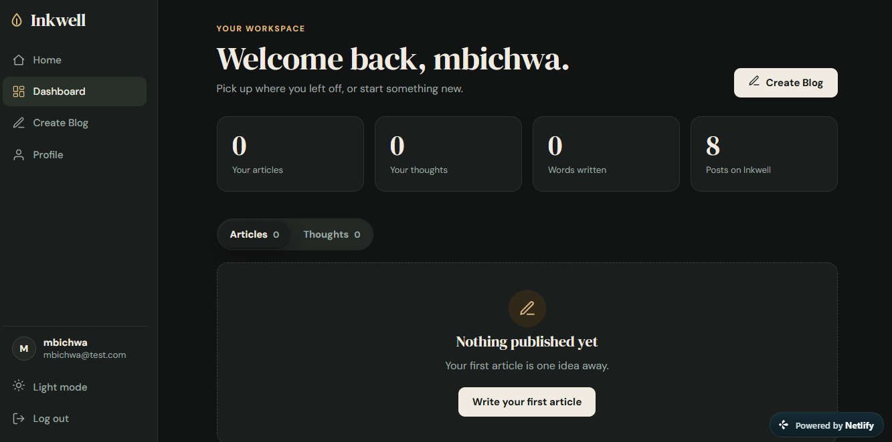
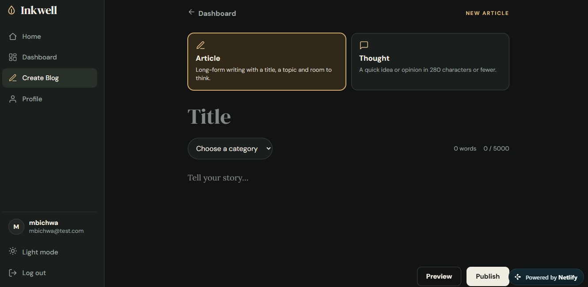

# Inkwell

> Every thought has a place.

Inkwell is a full-stack publishing platform where people write long-form **articles** and share short **thoughts** (up to 280 characters). It pairs an editorial reading experience with a lightweight social feel, and it was built from scratch with vanilla JavaScript, Node.js and PostgreSQL.

**Live demo:** [https://your-site.netlify.app](https://your-site.netlify.app)
**API health check:** [https://your-service.onrender.com/api/health](https://your-service.onrender.com/api/health)

> The API runs on a free hosting tier and sleeps when idle, so the first request after a quiet period can take up to a minute.


| Dashboard | Writing studio | Dark mode |
|---|---|---|
|  |  |  |

## Features

- **Two content types:** long-form articles (title, category, body) and short thoughts, each with its own composer and reading layout
- **Full CRUD:** create, read, update and delete your posts, with a live preview and an "Edited" label
- **Discovery:** featured articles, community thoughts, search, category filters, trending topics and writers to read
- **Accounts:** registration, login, a profile page, password change and "log out everywhere"
- **Private dashboard:** shows only the logged-in user's own posts and stats
- **Light and dark themes** that remember your choice, with a layout designed for desktop, tablet and phone
- **Accessible by default:** keyboard navigation, visible focus states, labelled controls and reduced-motion support

## Tech stack

| Layer | Technology |
|---|---|
| Frontend | HTML5, CSS3 (custom properties, Grid, Flexbox), vanilla JavaScript (ES2020) |
| Backend | Node.js, Express |
| Database | Supabase (PostgreSQL) |
| Auth | JSON Web Tokens (`jsonwebtoken`), `bcryptjs` |
| Security middleware | `helmet`, `cors`, `express-rate-limit` |
| Hosting | Netlify (frontend), Render (API), Supabase (database) |

## Architecture

```
Browser ──► Netlify (static HTML, CSS, JS)
   │
   └──────► Render (Express REST API) ──► Supabase (PostgreSQL)
```

The frontend is plain static files. All data goes through the Express API, which is the only thing that talks to the database.

## Project structure

```
inkwell/
├── backend/
│   ├── server.js           # app setup, security middleware, routes
│   ├── supabase.js         # database client (server-side key)
│   ├── schema.sql          # full database schema
│   ├── middleware/auth.js  # JWT verification
│   └── routes/
│       ├── auth.js         # register, login, profile, password
│       └── posts.js        # posts CRUD, search and filters
└── frontend/
    ├── index.html          # home
    ├── login.html, register.html
    ├── dashboard.html, create-blog.html, post.html, profile.html
    ├── css/style.css       # design system (light and dark themes)
    └── js/app.js           # shared UI, API client, page logic
```

## Getting started

### Prerequisites

- Node.js 18 or newer
- A free [Supabase](https://supabase.com) project

### 1. Clone

```bash
git clone https://github.com/[your-username]/[your-repo].git
cd [your-repo]
```

### 2. Set up the database

In your Supabase project, open **SQL Editor**, paste the contents of `backend/schema.sql` and run it. Then, under **Project Settings → API**, copy the **Project URL** and the **service_role / secret key**.

### 3. Run the backend

```bash
cd backend
npm install
cp .env.example .env     # then fill in the values
npm run dev
```

The API starts on `http://localhost:5000`. Check `http://localhost:5000/api/health`.

### 4. Run the frontend

Serve the `frontend` folder with any static server, for example the VS Code **Live Server** extension, or:

```bash
npx serve frontend -l 5500
```

Open `http://localhost:5500`. When the page is served from `localhost`, the app automatically uses the local API.

## Environment variables

| Variable | Description |
|---|---|
| `PORT` | Port for the API (Render sets this automatically) |
| `JWT_SECRET` | Secret used to sign tokens. At least 32 random characters |
| `CLIENT_ORIGINS` | Comma-separated list of frontend URLs allowed by CORS |
| `SUPABASE_URL` | Your Supabase project URL |
| `SUPABASE_SERVICE_KEY` | Supabase secret key. Server-side only, never expose it |

## API reference

| Method | Endpoint | Auth | Description |
|---|---|---|---|
| GET | `/api/health` | No | Health check |
| POST | `/api/auth/register` | No | Create an account |
| POST | `/api/auth/login` | No | Log in and receive a token |
| GET | `/api/auth/me` | Yes | Current user |
| PATCH | `/api/auth/me` | Yes | Change display name |
| POST | `/api/auth/password` | Yes | Change password (logs out other devices) |
| POST | `/api/auth/logout-all` | Yes | End every session on every device |
| GET | `/api/posts` | No | All posts. Optional `?q=` and `?category=` filters |
| GET | `/api/posts/mine` | Yes | Only the logged-in user's posts |
| GET | `/api/posts/:id` | No | A single post |
| POST | `/api/posts` | Yes | Create an article or thought |
| PUT | `/api/posts/:id` | Yes (owner) | Edit a post |
| DELETE | `/api/posts/:id` | Yes (owner) | Delete a post |

Protected routes expect `Authorization: Bearer <token>`.

## Security

- Passwords are hashed with **bcrypt**; login runs a dummy comparison for unknown emails so response time doesn't reveal which accounts exist
- **JWTs** are signed with HS256 (the algorithm is pinned on verification) and expire after 24 hours
- Each token carries a **version** that is checked against the database, so changing your password or choosing "log out everywhere" instantly invalidates older tokens
- **Ownership is enforced on the server**: a user can only edit or delete their own posts, whatever the UI shows
- Database tables have **Row Level Security** enabled with no public policies, so only the backend's secret key can access them
- **Rate limiting** on login, registration and password change; **Helmet** security headers; a **CORS allow-list**
- All user content is **escaped** before rendering to prevent XSS, and inputs are validated both in the app and by database constraints

## Deployment

- **Database:** Supabase
- **API:** Render web service. Root directory `backend`, build `npm install`, start `npm start`, health check path `/api/health`
- **Frontend:** Netlify, publishing the `frontend` folder (configured in `netlify.toml`)

Set `CLIENT_ORIGINS` on Render to your Netlify URL, and set `PROD_API` at the top of `frontend/js/app.js` to your Render URL.

## Known limitations and next steps

- The token is stored in `localStorage`. An `httpOnly` cookie is the stronger option but needs CSRF protection and a stricter CORS setup
- No email verification or password reset yet
- `GET /api/posts` returns every post, so pagination is the next scaling step
- Likes, comments and image uploads would each need their own tables and endpoints
- There are no automated tests yet; testing has been manual, covering the API and the UI

## What I learned

Designing a REST API and its validation rules, JWT authentication and session revocation, relational modelling with constraints, building a themeable responsive UI without a framework, and taking an app from localhost to production.

## Author

Built by Evans. GitHub: [@JustTrying652](https://github.com/JustTrying652)